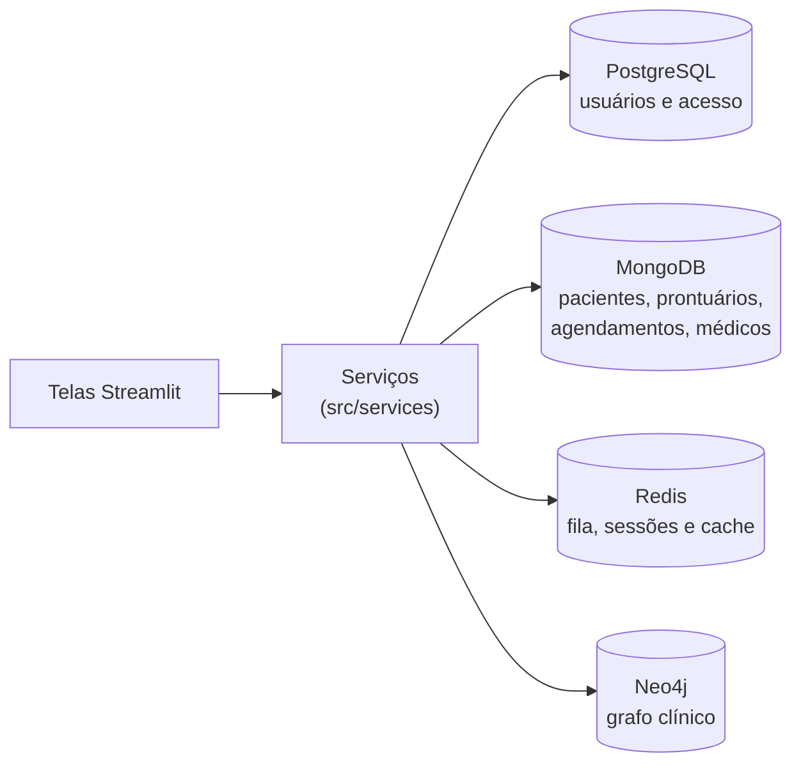

# Plataforma de Telemedicina & Gestão de Prontuários Médicos 👨‍⚕️📄

**Estudo de Caso 03: Plataforma de Telemedicina & Gestão de Prontuários Médicos**, desenvolvido na disciplina **Implementação e Gerenciamento de Bancos de Dados NoSQL**, ministrada pelo professor Ricardo Roberto.

A aplicação, feita em Python com Streamlit, cobre o ciclo de uma teleconsulta: 
1. login de médicos e recepcionistas
2. criação da consulta e do prontuário
3. fila da recepção virtual, 
4. finalização com laudo e prescrições
5. mapeamento clínico com alertas de segurança. 

Os dados ficam em quatro bancos, cada um escolhido pelo tipo de dado que guarda: PostgreSQL, MongoDB, Redis e Neo4j.

## Equipe

- Ismar Ferreira de Macêdo Neto
- Davi Medeiros Dantas Soares
- Augusto Luiz Lima Dantas
- Guilherme Di Lorenzo Pereira
- Lucca de Sena Barbosa
- Ryan Emanuel Lima Miranda

## Sumário

- [Funcionalidades](#funcionalidades)
- [Persistência poliglota](#persistência-poliglota)
- [Como executar](#como-executar)
- [Estrutura do projeto](#estrutura-do-projeto)
- [PostgreSQL: usuários e acesso](#postgresql-usuários-e-acesso)
- [MongoDB: médicos, pacientes, prontuários e agendamentos](#mongodb-médicos-pacientes-prontuários-e-agendamentos)
- [Recepção Virtual: fila e agenda](#recepção-virtual-fila-e-agenda)
- [Finalização de Consultas](#finalização-de-consultas)
- [Mapeamento Clínico e alertas de segurança (Neo4j)](#mapeamento-clínico-e-alertas-de-segurança-neo4j)
- [Redis: fila de espera e sessões](#redis-fila-de-espera-e-sessões)

## Funcionalidades

| Tela | O que faz | Bancos usados |
|---|---|---|
| **Login** | Autentica médicos e recepcionistas e abre a sessão | PostgreSQL, Redis |
| **Atendimento Médico** | Cria consultas com data e horário, mostra o histórico do paciente, edita diagnósticos e anexa documentos em PDF | PostgreSQL, MongoDB, Neo4j, Redis |
| **Recepção Virtual** | Fila de espera, chamada do próximo paciente, agenda do dia, consultas em atendimento e sessões ativas | Redis, MongoDB, PostgreSQL |
| **Consultas** (Finalização) | Finaliza a consulta com laudo, receita e prescrições | MongoDB, Neo4j, Redis |
| **Mapeamento Clínico** | Alertas de segurança, diagnósticos correlacionados e grafos de relações clínicas | Neo4j |

## Persistência poliglota

O projeto divide os dados da seguinte forma:



### O papel de cada banco

| Banco | O que guarda | Por que esse banco |
|---|---|---|
| **PostgreSQL** (relacional) | Tabela `usuarios`: nome, CPF, e-mail, senha, cargo e status de médicos e recepcionistas | Dados de acesso têm estrutura fixa e exigem integridade: `UNIQUE` em CPF e e-mail, `CHECK` em cargo e status e transações ACID. O `id` gerado aqui identifica o usuário em todos os outros bancos. |
| **MongoDB** (documentos) | Coleções `medicos`, `pacientes`, `prontuarios` e `agendamentos` | O prontuário é naturalmente um documento: cada paciente tem um, com as consultas embutidas (sintomas, diagnósticos, laudos em binário e receita) e as prescrições. O esquema é flexível, mas validado com `$jsonSchema`, e as telas usam pipelines de `aggregate`. |
| **Redis** (chave-valor em memória) | Fila de espera, sessões de usuários, tokens das consultas ativas e cache das agendas | São dados de acesso frequente e vida curta. O Redis responde em memória, tem estruturas prontas (Sorted Set para a fila, Hash para os dados de cada entrada) e expira as chaves sozinho com TTL. |
| **Neo4j** (grafo) | Nós `Paciente`, `Medico`, `Diagnostico` e `Medicamento`, ligados por atendimentos, diagnósticos, prescrições, interações e contraindicações | Os alertas e as correlações percorrem relacionamentos em vários níveis (paciente → medicamento → interação → outro medicamento; diagnóstico → paciente → diagnóstico). Em grafo, essas buscas são travessias diretas em Cypher, como `shortestPath`, em vez de várias junções. |

### Como os bancos se referenciam

A ligação é feita pelos identificadores, guardados como campos comuns e resolvidos pela aplicação:

| Identificador de origem | Onde aparece |
|---|---|
| `usuarios.id` (PostgreSQL) | MongoDB: `medicos.usuario_id`, `prontuarios.consultas.medico_id` e `agendamentos.medico_id`; Redis: `usuario_id` da sessão e chave `agenda:medico:<id>:<AAAA-MM-DD>`; Neo4j: propriedade `postgres_id` dos nós `(:Medico)` |
| `pacientes._id` (MongoDB) | MongoDB: `prontuarios.paciente_id` e `agendamentos.paciente_id`; Redis: `paciente_id` em `fila:consulta:<id>`; Neo4j: propriedade `mongo_id` dos nós `(:Paciente)` |
| `prontuarios.consultas._id` (MongoDB) | MongoDB: `agendamentos.consulta_id` e `prescricoes.consulta_id`; Redis: membro de `fila:espera` e chaves `fila:consulta:<id>` e `sessao_consulta:<id>`; Neo4j: propriedade `consulta_id` dos relacionamentos |


### Camada de acesso

- `src/config/database.py` abre uma conexão (ou pool) por banco, guardada com
  `st.cache_resource` para ser reaproveitada entre as execuções das telas.
- `src/repositories` isola a comunicação com cada banco: `PostgresRepository`,
  `MongoRepository` e `Neo4jRepository` (o Redis é usado pelo cliente
  `redis-py` diretamente nos serviços).
- `src/services` contém as regras de negócio e é onde os bancos se encontram:

| Serviço | Bancos |
|---|---|
| `UsuarioService` | PostgreSQL e MongoDB |
| `ProntuarioService` | MongoDB, Neo4j (pelo `MapeamentoClinicoService`) e PostgreSQL (pelo `UsuarioService`) |
| `MapeamentoClinicoService` | Neo4j |
| `AgendaCacheService` | Redis e MongoDB |
| `FilaService` e `SessaoService` | Redis |


## Estrutura do projeto

```text
src/
├── app.py            # login e navegação entre as telas
├── config/
│   ├── database.py   # conexões com os quatro bancos
│   └── seed.py       # cria estruturas e dados de exemplo
├── pages/            # uma pasta por tela do Streamlit
├── repositories/     # acesso ao PostgreSQL, MongoDB e Neo4j
├── services/         # regras de negócio e integração entre os bancos
└── tests/            # testes unitários com repositórios falsos
```


## Como executar

### Pré-requisitos

- Docker com Docker Compose
- Python 3.12 ou superior

### 1. Preparar o ambiente

Na raiz do projeto, crie o ambiente virtual, instale as dependências e copie os arquivos de configuração de exemplo:

```bash
python -m venv .venv
source .venv/bin/activate   # no Windows: .venv\Scripts\activate
pip install -r requirements.txt
cp .env-example .env
cp .streamlit/secrets-example.toml .streamlit/secrets.toml
```

O `.env` define as credenciais dos containers e o `.streamlit/secrets.toml`, as URLs usadas pela aplicação.

### 2. Subir os bancos

```bash
docker compose up -d
```

| Serviço | Endereço |
|---|---|
| PostgreSQL 17 | `localhost:5433` (a porta 5432 fica livre para um PostgreSQL instalado na máquina) |
| MongoDB 8 | `localhost:27018` |
| Redis 7 | `localhost:6379` |
| Neo4j 5 Browser | `http://localhost:7474` |
| Neo4j 5 Bolt | `bolt://localhost:7687` |

As credenciais vêm das variáveis `POSTGRES_USER`, `POSTGRES_PASSWORD`,
`POSTGRES_DB`, `MONGO_ROOT_USER`, `MONGO_ROOT_PASSWORD`, `REDIS_PASSWORD` e
`NEO4J_AUTH` do `.env`.

### 3. Gerar os dados de exemplo

```bash
python src/config/seed.py
```

O script cria a tabela `usuarios` no PostgreSQL, as coleções com validadores e
índices no MongoDB, o grafo e o catálogo clínico no Neo4j e o cache das agendas
futuras no Redis. Ele apaga os dados existentes e recria tudo a cada execução;
como também zera o Redis (fila, sessões e cache), é preciso entrar de novo na
aplicação.


### 4. Iniciar a aplicação

```bash
streamlit run src/app.py
```